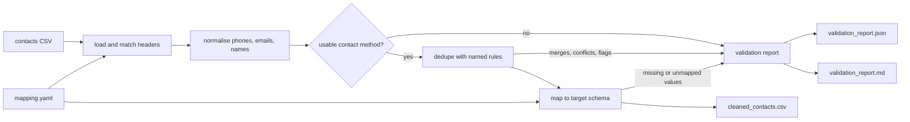

# crm-migration-kit

**Move a contact list into a new CRM without bringing the mess along, and with a written record of every change.**

This is for a business that is switching CRMs, or pulling spreadsheets and form exports into one system.
The list that comes out of the old system usually has the same person entered several times, phone numbers in five formats and column names the new system does not recognise.
Importing it as it is copies the mess. Cleaning it by hand in a spreadsheet leaves no record of what was changed.

Give this tool the exported CSV and it hands back:

- **a clean file ready to import**, with the columns named the way the new system expects
- **a plain language report** of every row it dropped, merged or flagged, with the reason, so a person can check the decisions before anything is loaded
- **a count that has to add up**: rows read = rows dropped + rows merged + rows written

Clear duplicates are merged. Doubtful ones, such as two people on one office phone line, are left alone and flagged for a person to decide.

The tool is `crm-migrate`, a Python command line program. It runs offline on your own machine and the contact data never leaves it.
It handles contacts only, reads and writes CSV files, and does not connect to any CRM (see [Limitations](#limitations)).

## What you will see

Lines taken from the real output of `python demo/run_demo.py` on the 29 row synthetic sample in `sample_data/`. The full output is in [`demo/output.txt`](demo/output.txt).

```
| Rows read | 29 |
| Rows dropped | 3 |
| Rows merged into another row | 7 |
| Rows written | 19 |
| Rows flagged for review | 9 |

Check: read = dropped + merged + written is true.

- Row 9: no_contact_method. No valid email or phone after normalisation.
- Kept row 5, merged in row(s) 6
  - phone_and_name: rows 5 and 6, same phone +15555550102 and name similarity 0.90 (threshold 0.82)
  - conflict on first_name: kept 'Jordan', discarded 'J.' from row 6
- Row 11: shared_phone. same phone +15555550104 but names differ (similarity 0.67), not merged (other row 12)
- Row 16: email_repaired. Email 'drew.testman@example,com' repaired to 'drew.testman@example.com', please confirm.
```

And the first rows of the cleaned file, where `SourceRows` lists the input rows behind each output row:

```
FirstName,LastName,DisplayName,Email,Phone,PhoneExtension,Account,LeadSource,City,Notes,ImportBatch,SourceRows
Alex,Sample,Alex Sample,alex.sample@example.com,+15555550101,,Example Property Group,Website,Sampleville,duplicate entry from old system,sample-batch-01,2 3 4
Jordan,Testerson,Jordan Testerson,jordan.testerson@example.com,+15555550102,204,Demo Rentals LLC,Referral,Faketown,,sample-batch-01,5 6
```

## What it does

1. **Loads** a contacts CSV. Headers are matched loosely (`" E-mail Address "` and `email_address` are the same column).
2. **Normalises** each row:
   - phones to `+15555550101` form, with extensions (`x204`, `ext. 7`) split into their own field
   - emails to lower case, with `mailto:` prefixes, `Name <address>` wrappers and trailing punctuation removed
   - names typed in ALL CAPS or as `Last, First` put back in order
   - placeholder text such as `n/a` or `none` treated as empty
3. **Drops** rows that are empty or have no usable email or phone, and says why.
4. **Dedupes** with five named rules:

   | Rule | Condition | Action |
   | --- | --- | --- |
   | `email_exact` | same email address (plus tags ignored) | merge |
   | `phone_and_name` | same phone and similar names | merge |
   | `phone_name_missing` | same phone, one record has no name, and the phone belongs to one name only | merge |
   | `shared_phone` | same phone, different names (or no name on a phone used by several names) | flag for review |
   | `name_and_company` | same name and company, nothing else in common | flag for review |

   When rows merge, the most complete row is kept, its blanks are filled from the others, and every disagreement between them is listed as a conflict.
5. **Maps** fields to the target schema from a YAML mapping: rename, combine with a template, translate values, set defaults and constants, mark fields required.
6. **Emits** three files:
   - `cleaned_contacts.csv`, ready to import, with an optional audit column listing the source rows behind each output row
   - `validation_report.json`, for scripts
   - `validation_report.md`, for people

The report always checks that rows read = rows dropped + rows merged + rows written, so nothing disappears silently.

## Architecture



| Module | Job |
| --- | --- |
| `normalize.py` | pure functions for phones, emails and names |
| `dedupe.py` | match rules, transitive grouping, survivor merge |
| `mapping.py` | YAML mapping loader, validation, field transforms |
| `pipeline.py` | wires the steps together, reads and writes files |
| `report.py` | counts, reasons, JSON and Markdown output |
| `cli.py` | `crm-migrate run` and `crm-migrate check-mapping` |

## Run it

Needs Python 3.10 or newer. The only runtime dependency is PyYAML. Nothing calls the network and no keys are needed.

```bash
python -m venv .venv && source .venv/bin/activate   # Windows: .venv\Scripts\activate
pip install -e ".[dev]"
crm-migrate run --input sample_data/contacts_messy.csv --mapping sample_data/mapping.yaml --out-dir out
```

Other commands:

```bash
# Validate a mapping and see how the CSV headers resolve, before running anything
crm-migrate check-mapping --mapping sample_data/mapping.yaml --input sample_data/contacts_messy.csv

# Use in a script: exit code 2 when any row is flagged
crm-migrate run --input in.csv --mapping mapping.yaml --out-dir out --quiet --fail-on-flags
```

Options for `run`: `--country-code` (default `1`), `--name-similarity` (default `0.82`), `--quiet`, `--fail-on-flags`.
The same two settings can come from the environment, see `.env.example`.
A bad mapping, a missing file, a setting out of range or an input that is not UTF-8 ends with a one line error and exit code 1.

## The mapping file

`sample_data/mapping.yaml` is a commented, working example. The short version:

```yaml
source_columns:            # canonical field -> headers seen in exports
  first_name: ["First Name"]
  last_name: ["Last Name"]
  email: ["E-mail Address", "Email Address"]
  phone: ["Phone #", "Mobile"]
  lead_source: ["Lead Source"]
rules:
  require_any: [email, phone]
target:
  audit_column: SourceRows
  fields:
    - name: DisplayName
      template: "{first_name} {last_name}"
    - name: LeadSource
      from: lead_source
      default: Unknown
      unmapped: Other
      value_map: {web: Website, referral: Referral}
    - name: ImportBatch
      constant: batch-01
```

Each target field takes exactly one of `from`, `template` or `constant`. A mapping that refers to a field that does not exist is rejected with a list of every problem found.

## Tests

```bash
pytest -q
```

61 tests cover the normalisers, each dedupe rule, mapping validation, the full pipeline on the sample file and the CLI. CI (`.github/workflows/ci.yml`) runs them on Python 3.10 and 3.12, then reruns the demo and fails if anything under `demo/` differs from what is committed.

## Demo

```bash
python demo/run_demo.py
```

This runs `check-mapping` and `run` on `sample_data/contacts_messy.csv`, 29 synthetic rows built to contain the usual problems. It rewrites `demo/output.txt` and the three files in `demo/out/`, so `git diff demo/` shows at once whether the behaviour changed. It ends with:

```
Read 29, dropped 3, merged 7, wrote 19, flagged 9 for review.
```

All sample data is invented: example.com addresses, 555-01xx phone numbers, made up names and companies.

## Where this pattern runs

This kit is drawn from systems that run two small service companies day to day, where contact lists arrive from old CRMs, spreadsheets and form exports and have to be merged into one system of record without losing track of what changed. The normalise, dedupe with reasons, map, report sequence is the same one used there. The code and data here are written fresh for this repository, and the only evidence it offers is what you can run yourself: the tests and the synthetic sample.

## Limitations

What has and has not been proven:

- **No CRM is connected, real or mocked.** There is no API client in this code. It reads a CSV and writes a CSV, and loading that file is left to the import tool of the target system.
- **The output has not been imported into a live CRM as part of this repository.** The target column names in `sample_data/mapping.yaml` are illustrative, not any vendor's import template. For a real migration you write the mapping against that system's import format.
- **It has only been run on synthetic data**: the 29 row sample, the test fixtures, and one informal run of 50,000 generated rows (about 6 seconds on a desktop, 4,557 duplicates merged). That is one run, not a benchmark.
- **Contacts only.** Companies, deals, notes, activities and attachments as separate objects are out of scope.

What the logic does not do:

- The same email always merges, whatever the names. Two people sharing one mailbox become one record; the discarded name is listed as a conflict in the report but is not in the cleaned file.
- A merge keeps one value per field. A second, different email or phone for the same person is reported as a conflict and not carried into the output.
- The survivor rule is fixed: most complete row wins, earliest row breaks ties. You cannot yet choose a different rule per field.
- Dedupe compares records within one file. It does not check against contacts already in the target CRM.
- Phone handling is built for North American numbers. Other countries work only when the number starts with `+` (8 to 15 digits accepted, no per country length check) or has 10 digits and you set the default country code. A national format such as `020 7946 0958` is flagged as unreadable.
- Email validation is a syntax check. It does not test whether a mailbox exists, and the only typo it repairs is a comma in the domain.
- Name matching is string similarity plus an initial rule. It does not know nicknames, so a short and a long first name that share only a phone are flagged, not merged. `Pat Sampleton Jr.` splits with `Jr.` as the last name, and `MCDONALD` becomes `Mcdonald`.
- Input must be UTF-8 (with or without a byte order mark). An export in another encoding is refused with a one line error, not converted.
- Row numbers in the report assume one record per line. A cell with an embedded line break shifts the numbers after it.
- Everything is held in memory, and building the merge report slows down faster than the row count grows. Not designed for millions of rows.

## License

License: MIT, see the LICENSE file.
