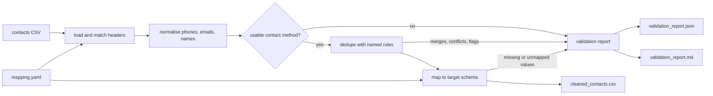

# crm-migration-kit

Contact exports from an old CRM are messy: five phone formats, the same person entered three times, headers nobody agreed on.
Loading that straight into a new system copies the mess, and fixing it by hand in a spreadsheet leaves no record of what was changed.

`crm-migrate` is a small command line tool that cleans a contacts CSV, removes duplicates with rules you can read back, maps the columns to the target schema through a YAML file, and writes a report of every row it dropped, merged or flagged.

## What it does

1. **Loads** a contacts CSV. Headers are matched loosely (`" E-mail Address "` and `email_address` are the same column).
2. **Normalises** each row:
   - phones to `+15555550101` form, with extensions (`x204`, `ext. 7`) split into their own field
   - emails to lower case, with `mailto:` prefixes, `Name <address>` wrappers and trailing punctuation removed
   - names typed in ALL CAPS or as `Last, First` put back in order
   - placeholder text such as `n/a` or `none` treated as empty
3. **Drops** rows that are empty or have no usable email or phone, and says why.
4. **Dedupes** with five named rules:

   | Rule | Condition | Action |
   | --- | --- | --- |
   | `email_exact` | same email address (plus tags ignored) | merge |
   | `phone_and_name` | same phone and similar names | merge |
   | `phone_name_missing` | same phone and one record has no name | merge |
   | `shared_phone` | same phone, different names | flag for review |
   | `name_and_company` | same name and company, nothing else in common | flag for review |

   When rows merge, the most complete row is kept, its blanks are filled from the others, and every disagreement between them is listed as a conflict.
5. **Maps** fields to the target schema from a YAML mapping: rename, combine with a template, translate values, set defaults and constants, mark fields required.
6. **Emits** three files:
   - `cleaned_contacts.csv`, ready to import, with an optional audit column listing the source rows behind each output row
   - `validation_report.json`, for scripts
   - `validation_report.md`, for people

The report always checks that rows read = rows dropped + rows merged + rows written, so nothing disappears silently.

## Architecture



| Module | Job |
| --- | --- |
| `normalize.py` | pure functions for phones, emails and names |
| `dedupe.py` | match rules, transitive grouping, survivor merge |
| `mapping.py` | YAML mapping loader, validation, field transforms |
| `pipeline.py` | wires the steps together, reads and writes files |
| `report.py` | counts, reasons, JSON and Markdown output |
| `cli.py` | `crm-migrate run` and `crm-migrate check-mapping` |

## Run it

Needs Python 3.10 or newer. The only runtime dependency is PyYAML. Nothing calls the network and no keys are needed.

```bash
python -m venv .venv && source .venv/bin/activate   # Windows: .venv\Scripts\activate
pip install -e ".[dev]"
crm-migrate run --input sample_data/contacts_messy.csv --mapping sample_data/mapping.yaml --out-dir out
```

Other commands:

```bash
# Validate a mapping and see how the CSV headers resolve, before running anything
crm-migrate check-mapping --mapping sample_data/mapping.yaml --input sample_data/contacts_messy.csv

# Use in a script: exit code 2 when any row is flagged
crm-migrate run --input in.csv --mapping mapping.yaml --out-dir out --quiet --fail-on-flags
```

Options for `run`: `--country-code` (default `1`), `--name-similarity` (default `0.82`), `--quiet`, `--fail-on-flags`.
The same two settings can come from the environment, see `.env.example`.

## The mapping file

`sample_data/mapping.yaml` is a commented, working example. The short version:

```yaml
source_columns:            # canonical field -> headers seen in exports
  email: ["E-mail Address", "Email Address"]
  phone: ["Phone #", "Mobile"]
rules:
  require_any: [email, phone]
target:
  audit_column: SourceRows
  fields:
    - name: DisplayName
      template: "{first_name} {last_name}"
    - name: LeadSource
      from: lead_source
      default: Unknown
      unmapped: Other
      value_map: {web: Website, referral: Referral}
    - name: ImportBatch
      constant: batch-01
```

Each target field takes exactly one of `from`, `template` or `constant`. A mapping that refers to a field that does not exist is rejected with a list of every problem found.

## Tests

```bash
pytest -q
```

56 tests cover the normalisers, each dedupe rule, mapping validation, the full pipeline on the sample file and the CLI. CI (`.github/workflows/ci.yml`) runs them on Python 3.10 and 3.12 and checks that the demo still produces the captured output.

## Demo

```bash
python demo/run_demo.py
```

This runs the tool on `sample_data/contacts_messy.csv`, 29 synthetic rows built to contain the usual problems. The captured output is in `demo/output.txt` and the files it wrote are in `demo/out/`. The summary:

```
Read 29, dropped 3, merged 7, wrote 19, flagged 9 for review.
```

A sample of the explanations in the report:

```
- Kept row 5, merged in row(s) 6
  - phone_and_name: rows 5 and 6, same phone +15555550102 and name similarity 0.90 (threshold 0.82)
  - conflict on first_name: kept 'Jordan', discarded 'J.' from row 6
- Row 11: shared_phone. same phone +15555550104 but names differ (similarity 0.67), not merged (other row 12)
- Row 16: email_repaired. Email 'drew.testman@example,com' repaired to 'drew.testman@example.com', please confirm.
```

All sample data is invented: example.com addresses, 555-01xx phone numbers, made up names and companies.

## Where this pattern runs

This kit is drawn from systems that run two small service companies day to day, where contact lists arrive from old CRMs, spreadsheets and form exports and have to be merged into one system of record without losing track of what changed. The normalise, dedupe with reasons, map, report sequence is the same one used there. The code and data here are written fresh for this repository.

## Limitations

- Phone handling is built for North American numbers. Other countries work only when the number starts with `+`, or has 10 digits and you set the default country code. There is no per country length validation.
- Email validation is a syntax check. It does not test whether a mailbox exists, and the only typo it repairs is a comma in the domain.
- Name matching is string similarity plus an initial rule. It does not know nicknames, so two records for the same person under a short and a long first name that share only a phone are flagged, not merged.
- Dedupe compares records within one file. It does not check against contacts already in the target CRM.
- The survivor rule is fixed: most complete row wins, earliest row breaks ties. Conflicts are reported but you cannot yet choose a different rule per field.
- Row numbers in the report assume one record per line. A cell with an embedded line break shifts the numbers after it.
- Everything is held in memory. Fine for tens of thousands of rows, not designed for millions.
- It writes CSV only. Pushing to a CRM API is left to the import tool of the target system.

## License

License: MIT, see the LICENSE file.
